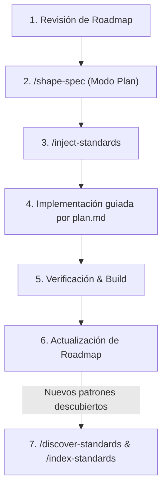

# AgentOS - Cartelera de Cine 🎬

Proyecto de cartelera cinematográfica interactiva desarrollada con **React 19**, **Vite** y **Tailwind CSS**, consumiendo la API de **TMDB (The Movie Database)** y construido mediante el trabajo coordinado de agentes de Inteligencia Artificial bajo la metodología **AgentOS**.

---

## 🧠 ¿Qué es la Metodología AgentOS?

**AgentOS** es un marco de trabajo (*framework*) diseñado para que desarrolladores y agentes de IA colaboren de forma predecible, disciplinada y de alta calidad. Organiza el conocimiento y el ciclo de vida del desarrollo en tres pilares clave dentro de la carpeta `agent-os/`:

- 📍 **`agent-os/product/` (El Qué y Para Quién)**: Contiene la misión del producto (`mission.md`), el mapa de ruta (`roadmap.md`) y las definiciones del stack tecnológico (`tech-stack.md`).
- 📏 **`agent-os/standards/` (Las Reglas y Buenas Prácticas)**: Repositorio central de convenciones, estándares de API, patrones de arquitectura y guías de código (`index.yml` y carpetas de estándares).
- 📋 **`agent-os/specs/` (El Plan de Trabajo por Iteración)**: Cada ciclo o funcionalidad cuenta con su propia carpeta versionada (`YYYY-MM-DD-HHMM-nombre-feature/`), conteniendo el plan de tareas (`plan.md`), contexto de shaping (`shape.md`), estándares requeridos (`standards.md`) y referencias de código (`references.md`).

---

## 🔄 Flujo de Trabajo Paso a Paso en Cada "Vuelta" (Ciclo) de AgentOS

Cada vez que vayas a iniciar una nueva iteración o vuelta de desarrollo (por ejemplo: agregar un nuevo filtro, una vista de detalle, o una nueva integración), sigue este ciclo sistemático:



---

### Paso 0: Definición o Revisión de Producto (Inicio de proyecto o cambio de rumbo)

Si el proyecto está comenzando o necesitas redefinir la visión general, metas o stack:

```text
/plan-product
```

* **Qué hace:** Inicia una conversación guiada para definir o actualizar:
  - `agent-os/product/mission.md` (problema, público objetivo y solución).
  - `agent-os/product/tech-stack.md` (librerías, frameworks y decisiones técnicas).
  - `agent-os/product/roadmap.md` (fases, hitos y funcionalidades planificadas).
* **Si ya está creado:** Consulta `agent-os/product/roadmap.md` para seleccionar la siguiente funcionalidad a construir.

---

### Paso 1: Conceptualización y Especificación (*Shaping & Planning*)

Antes de escribir una sola línea de código para una nueva característica, debes estructurar la especificación:

1. **Activa el modo de planificación** en tu asistente/agente (Plan Mode).
2. **Ejecuta el comando:**

```text
/shape-spec
```

* **Qué hace el agente paso a paso:**
  1. **Aclarar alcance:** Te preguntará qué se va a construir, restricciones y resultados esperados.
  2. **Recopilar visuales:** Solicita bocetos, wireframes o capturas de referencia (o indicarle si no aplica).
  3. **Identificar código de referencia:** Pide archivos o patrones existentes en el proyecto a tomar de modelo.
  4. **Verificar contexto del producto:** Revisa la alineación con `agent-os/product/`.
  5. **Vincular estándares:** Lee `agent-os/standards/index.yml` y propone qué estándares aplican a este trabajo.
  6. **Crear carpeta de la spec:** Genera `agent-os/specs/YYYY-MM-DD-HHMM-{slug}/`.
  7. **Estructurar el plan:** Crea `plan.md` donde la **Tarea 1 (T001)** siempre es persistir la documentación (`shape.md`, `standards.md`, `references.md`), seguida de las tareas de implementación divididas y verificables.

---

### Paso 2: Inyección de Estándares en el Contexto (*Context Injection*)

Para asegurarte de que el agente conozca al pie de la letra las reglas de arquitectura y buenas prácticas antes de programar:

```text
# Modo automático (el agente detecta los estándares aplicables según la conversación/spec):
/inject-standards

# O modo explícito (inyectar una categoría o archivo concreto):
/inject-standards api
/inject-standards api/tmdb-client
```

* **Qué hace:** Carga de manera concisa las directrices en la ventana de contexto del agente, evitando que invente convenciones arbitrarias o repita errores.

---

### Paso 3: Implementación y Ejecución de Tareas

Pasa al modo de ejecución/edición y pídele al agente que ejecute el plan acordado:

1. El agente confirmará la **Tarea 1**: guardar los archivos de la spec en `agent-os/specs/{directorio}/`.
2. Procede tarea por tarea según lo definido en `plan.md` (modificación de componentes React, llamadas a la API, estilos CSS, etc.).
3. El agente se apoya en los criterios de aceptación y mapeo de requerimientos estipulados en la spec.

---

### Paso 4: Verificación y Cierre de la Vuelta

Una vez implementada la funcionalidad:

1. **Validación técnica y compilación:**
   ```bash
   npm run build
   ```
2. **Comprobación funcional:**
   ```bash
   npm run dev
   ```
   Verificar en el navegador los casos de uso, estados de carga, errores y casos límite.
3. **Actualización de documentación:**
   - Marcar como completada la tarea en la spec.
   - Actualizar `agent-os/product/roadmap.md` reflejando el nuevo estado de la funcionalidad.

---

### Paso 5: Extracción y Mantenimiento de Estándares (Opcional / Cierre de ciclo)

Si durante la iteración se consolidaron nuevos patrones útiles para futuros agentes:

1. **Descubrir nuevos estándares:**
   ```text
   /discover-standards
   ```
   Analiza el código desarrollado para extraer conocimiento tribal y documentarlo en `agent-os/standards/`.

2. **Reindexar estándares:**
   ```text
   /index-standards
   ```
   Actualiza `agent-os/standards/index.yml` para que los nuevos estándares queden disponibles para el comando `/inject-standards` y `/shape-spec`.

---

## 📋 Resumen de Comandos AgentOS

| Comando | Cuándo usarlo | Propósito principal |
|---|---|---|
| `/plan-product` | Al inicio del proyecto o al replantear la visión | Define `mission.md`, `roadmap.md` y `tech-stack.md`. |
| `/shape-spec` | Al iniciar cualquier nueva funcionalidad o feature | Crea la carpeta en `specs/` con `plan.md`, `shape.md`, referencias y estándares. |
| `/inject-standards` | Antes de codificar o durante la planificación | Carga estándares específicos en la memoria del agente. |
| `/discover-standards` | Al finalizar código nuevo con patrones reutilizables | Extrae patrones del código hacia `agent-os/standards/`. |
| `/index-standards` | Tras crear o modificar estándares | Actualiza el índice `agent-os/standards/index.yml`. |

---

## 🚀 Instalación y Puesta en Marcha del Proyecto

### Requisitos Previos
- **Node.js** (v18 o superior recomendado)
- Cuenta y API Key de **TMDB** ([The Movie Database API](https://www.themoviedb.org/settings/api))

### Pasos de Configuración

1. **Clonar e instalar dependencias:**
   ```bash
   npm install
   ```

2. **Configurar variables de entorno:**
   Copia el archivo de ejemplo y coloca tu API Key de TMDB:
   ```bash
   cp .env.example .env
   ```
   Edita `.env` con tu clave:
   ```env
   VITE_TMDB_API_KEY=tu_api_key_aqui
   ```

3. **Iniciar el servidor de desarrollo:**
   ```bash
   npm run dev
   ```

4. **Compilar para producción:**
   ```bash
   npm run build
   ```
